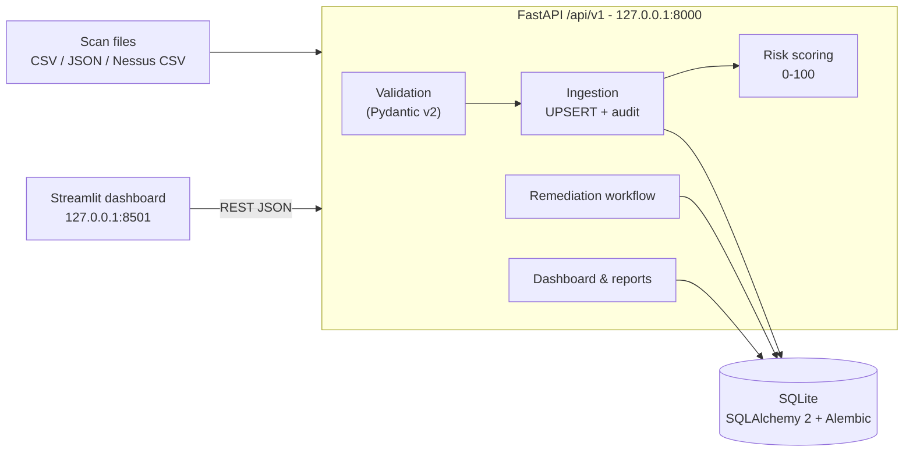

# CyberRemediate 360 — Vulnerability & Cyber Risk Management Platform

[](https://github.com/jee-iyed/CyberRemediate360/actions/workflows/ci.yml)

CyberRemediate 360 turns raw vulnerability scanner output into a **prioritised, tracked and auditable remediation programme**. It imports and validates scan results, keeps an asset inventory, ranks findings with an explainable risk score, enforces a remediation workflow (mitigation, fix, risk acceptance, false positive), records an audit trail and produces a CISO (RSSI) report.

It runs **entirely offline on a laptop** — FastAPI + SQLite + Streamlit, no Docker, no external service.

> **Portfolio / demonstration project.** Demo data is fictional (`CVE-DEMO-*`, fictional company, RFC 5737 documentation IP addresses) and flagged `is_demo`. Access control is demo-grade (see [docs/security.md](docs/security.md)).

## Features

| # | Capability | Where |
|---|---|---|
| 1 | **Asset inventory** – exposure, business criticality, owner, environment | `/api/v1/assets`, *Asset Inventory* page |
| 2 | **Vulnerability import** – normalised CSV/JSON + Nessus CSV adapter, 5 MB / 50k-row limits | `POST /api/v1/imports`, *Import Reports* page |
| 3 | **Validation & normalisation** – IP (v4/v6), CVE format, CVSS 0–10 as float, enums, dates, duplicates, encodings, per-line error report | `services/validation.py`, `services/parsers.py` |
| 4 | **Risk scoring** – deterministic 0–100 score = CVSS severity + exposure + criticality + threat (KEV/EPSS, no double count), with justification | `services/scoring.py`, [docs/risk_scoring.md](docs/risk_scoring.md) |
| 5 | **Remediation management** – owner, SLA due dates, evidence, verification, enforced transitions | `services/remediation.py`, *Remediation Tracker* |
| 6 | **SOC/GRC dashboard** – KPIs, severity/status/priority charts, top-10 assets, weekly trends, demo/real data filter | `frontend/app.py` |
| 7 | **CISO reporting** – PDF (9 sections), CSV (formula-injection safe), JSON | `GET /api/v1/reports/export` |
| 8 | **Audit trail** – who changed what, previous/new values | `GET /api/v1/audit-events` |
| 9 | **Idempotent UPSERT** – business keys, one transaction per import, regression re-open, never auto-close on absence | `services/ingestion.py` |
| 10 | **Automated tests & CI** – 82 pytest tests, Ruff lint/format, GitHub Actions | `tests/`, `.github/workflows/ci.yml` |

## Architecture



Details: [docs/architecture.md](docs/architecture.md) · data model: [docs/data_model.md](docs/data_model.md) · API: [docs/api.md](docs/api.md).

```
backend/app/
  api/routes.py          REST endpoints (/api/v1)
  core/                  config, database, domain enums, errors, security, UTC helpers
  models/entities.py     Asset, Vulnerability, Finding, Remediation, AuditEvent, ImportJob
  schemas/api.py         Pydantic request/response models
  repositories/          filtered / sorted / paginated queries
  services/              parsers, validation, ingestion, scoring, risk, remediation,
                         dashboard, reporting, audit
  main.py                FastAPI app (CORS, security headers, error handlers)
backend/migrations/      Alembic: 0001 legacy baseline, 0002 platform schema (data-preserving)
frontend/                Streamlit app + API client
scripts/                 init_db.py, seed_demo.py, legacy/ (original prototype scripts)
data/samples/            demo & synthetic sample files
tests/                   pytest suite (isolated temporary SQLite database)
docs/                    architecture, data model, API, scoring, security, demo, interview notes
```

## Technologies

Python 3.11 · FastAPI 0.115 · Pydantic 2.10 · SQLAlchemy 2.0 · Alembic 1.14 · SQLite · Streamlit 1.41 · Plotly · Pandas · ReportLab · httpx · pytest · Ruff · GitHub Actions.

## Installation (Windows PowerShell)

```powershell
git clone https://github.com/jee-iyed/CyberRemediate360.git
cd CyberRemediate360
py -3.11 -m venv .venv                    # without the py launcher: <path to Python 3.11>\python.exe -m venv .venv
.\.venv\Scripts\Activate.ps1
python -m pip install --upgrade pip
pip install -r requirements-dev.txt        # or requirements.txt for runtime only
Copy-Item .env.example .env                # optional: edit settings
python scripts\seed_demo.py                # create/migrate the DB and load the demo scenario
```

`scripts/init_db.py` alone creates or upgrades the database without demo data. Upgrading an existing database writes a backup to `data/backups/` first.

## Run

Terminal 1 – API (Swagger at http://127.0.0.1:8000/docs):

```powershell
.\.venv\Scripts\Activate.ps1
uvicorn app.main:app --app-dir backend --host 127.0.0.1 --port 8000
```

Terminal 2 – dashboard (http://127.0.0.1:8501):

```powershell
.\.venv\Scripts\Activate.ps1
streamlit run frontend\app.py
```

Optional write protection: set `CR360_API_KEY` in `.env` (generate with `python -c "import secrets; print(secrets.token_urlsafe(32))"`); the dashboard reads the same variable and sends it as `X-API-Key`.

## Usage

1. **Import** a file on *Import Reports* (or `POST /api/v1/imports`). Use *Demo mode* for `CVE-DEMO-*` files. The job report lists new / updated / rejected / duplicate rows with line-level reasons.
2. **Prioritise** on *Risk Prioritization*: findings sorted by score, with the per-component explanation of each score.
3. **Complete the inventory** on *Asset Inventory*: changing exposure or criticality re-scores the asset's findings.
4. **Remediate** on *Remediation Tracker*: create a plan (SLA due date by priority), move it through `in_progress → mitigated → resolved` or `accepted` / `false_positive` with the required evidence or justification.
5. **Report** on *RSSI Reporting*: PDF, CSV or JSON from the current data.

## Demo data

| File | Content |
|---|---|
| `data/samples/vulnerabilities.csv` | Original 4 prototype findings (`CVE-DEMO-001..004`) |
| `data/samples/demo_scenario.csv` | Fictional *Helios Logistics* scenario: 14 findings, owners, ports, dates, simulated threat signals |
| `data/samples/demo_findings.json` | 2 findings in JSON format (incl. IPv6 documentation address) |
| `data/samples/nessus_export_sample.csv` | Synthetic file in Nessus CSV layout, fictional hosts, real public CVE ids |
| `data/samples/invalid_examples.csv` | Rows that must be rejected (CVSS 15.0, bad IP, malformed CVE, missing field, bad enums, duplicate) |

A 5-minute guided demo: [docs/demo_walkthrough.md](docs/demo_walkthrough.md).

## Tests & quality

```powershell
pytest                       # 82 tests, temporary isolated SQLite database
ruff check backend frontend scripts tests
ruff format --check backend frontend scripts tests
```

Coverage of `backend/app` measured locally: 94 % (`pytest --cov=backend/app`). Covered: valid CSV, invalid CVSS/IP/CVE, missing fields, normalisation, duplicates, idempotence, UPSERT, SQL integrity (FK, CHECK, unique), transaction rollback, API CRUD, Pydantic validation, prioritisation order and bounds, workflow transitions, audit trail, reports, API key / CORS / SQL-injection / CSV-injection checks, legacy migration. The Streamlit UI is verified manually (not automated).

## Limitations

See [docs/limitations.md](docs/limitations.md). In short: demo-grade access control (shared API key, unauthenticated actor label), no online EPSS/KEV enrichment, heuristic (non-probabilistic) score, PostgreSQL/Docker paths not tested, Nessus adapter tested on a synthetic file only, UI not covered by automated tests.

## Roadmap

* OIDC authentication and RBAC (analyst / owner / approver / auditor), approval step for risk acceptance.
* Offline-capable KEV/EPSS enrichment job with source and date tracking.
* `.nessus` XML, OpenVAS and Trivy adapters.
* PostgreSQL deployment profile with tested Docker Compose; SQL-side aggregations.
* Tamper-evident audit log (hash chain) and SIEM export.
* Historical backlog snapshots for true risk-over-time curves.

## Skills demonstrated

Vulnerability management lifecycle (CVE, CWE, CVSS, EPSS, KEV) · risk-based prioritisation · GRC concepts (risk acceptance, residual risk, evidence, SLA, audit trail) · secure API design (validation, least exposure, injection defences) · relational modelling with business keys, constraints and migrations · idempotent data pipelines · FastAPI/Pydantic/SQLAlchemy · Streamlit data apps · PDF reporting · pytest/Ruff/GitHub Actions · honest documentation of limits.

Interview notes (EN/FR): [docs/interview_explanation.md](docs/interview_explanation.md) · design decisions: [docs/technical_decisions.md](docs/technical_decisions.md).
