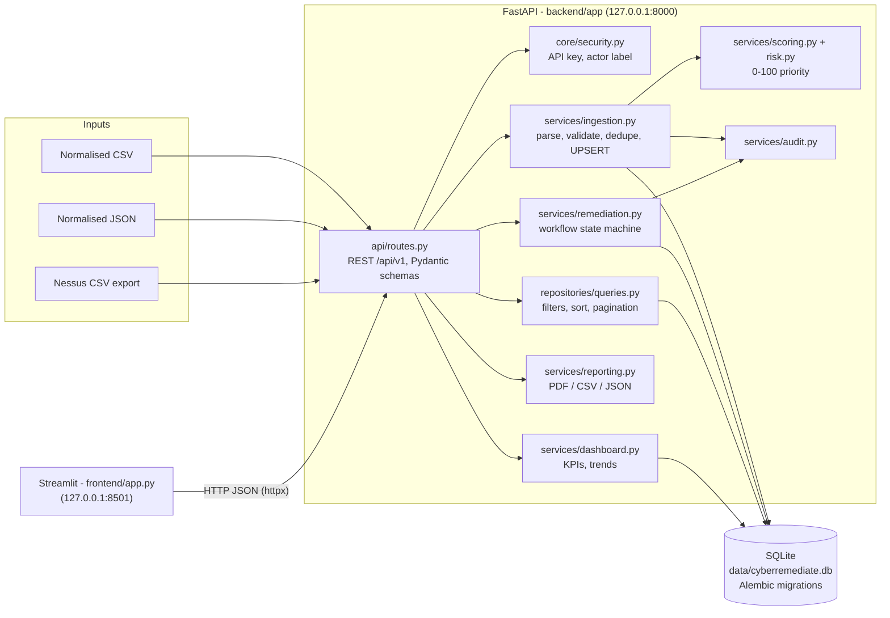

# Architecture

CyberRemediate 360 is a deliberately simple **modular monolith**: one FastAPI process, one SQLite file, one Streamlit process. No Docker, broker, cache or microservice is needed to run it on a laptop.

## Layers

| Layer | Folder | Responsibility |
|---|---|---|
| Presentation | `frontend/` | Streamlit pages; talks **only** to the REST API (`api_client.py`). |
| API | `backend/app/api/` | HTTP routing, request validation, status codes, dependency injection (DB session, auth, actor). |
| Schemas | `backend/app/schemas/` | Pydantic v2 request/response contracts (`extra="forbid"` on writes). |
| Services | `backend/app/services/` | Business logic: validation, parsing, ingestion, scoring, workflow, dashboard, reporting, audit. No HTTP code. |
| Repositories | `backend/app/repositories/` | Read queries with allow-listed sorting and escaped search terms. |
| Models | `backend/app/models/` | SQLAlchemy 2.x ORM entities, constraints and indexes. |
| Core | `backend/app/core/` | Settings, DB engine, UTC helpers, domain vocabularies, errors, security. |
| Migrations | `backend/migrations/` | Alembic: legacy baseline + platform schema (data-preserving). |
| Scripts | `scripts/` | `init_db.py` (backup + migrate + score), `seed_demo.py` (demo scenario), `legacy/` (original prototype scripts, kept for history). |

## Request lifecycle: import

1. `POST /api/v1/imports` → `require_write_access` → file read with a hard byte limit.
2. `parsers.py`: extension check, decode, CSV/JSON/Nessus parsing (pure data, nothing executed).
3. `validation.py`: one Pydantic `FindingRecord` per row → errors with line numbers.
4. In-file duplicates removed by business key.
5. `ingestion.py`: UPSERT asset → vulnerability → finding in **one transaction**, regression rule, audit events.
6. `risk.py`: re-score touched findings (and findings whose asset/vulnerability context changed).
7. `ImportJob` persisted with counts, errors and warnings; commit.

## Deployment

* Default: local, offline, `127.0.0.1` only (see README).
* The ORM keeps the code portable to PostgreSQL (`CR360_DATABASE_URL=postgresql+psycopg://...`), but this path is **not tested** in this repository (see [limitations.md](limitations.md)). Docker/Compose files are intentionally not provided because they could not be tested on the development machine.
