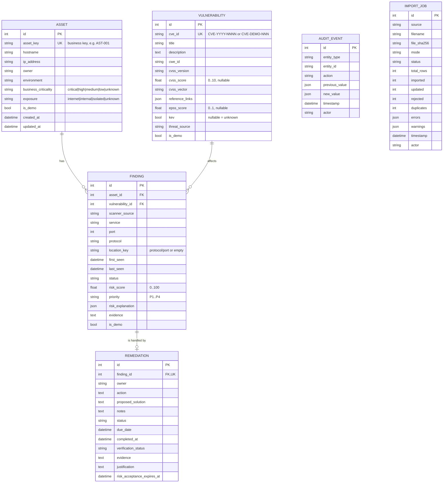

# Data model

SQLAlchemy 2.x models: `backend/app/models/entities.py`. Schema evolution: Alembic (`backend/migrations/`).

## Keys, constraints and indexes

| Table | Business key | Constraints | Indexes |
|---|---|---|---|
| assets | `asset_key` (unique, upper-case) | CHECK criticality / exposure in vocabulary | hostname, ip_address |
| vulnerabilities | `cve_id` (unique) | CHECK `cvss_score` 0–10, `epss_score` 0–1 | – |
| findings | (`asset_id`, `vulnerability_id`, `location_key`) unique | FK → assets, vulnerabilities (`ON DELETE RESTRICT`); CHECK status, port 0–65535, risk 0–100 | asset_id, vulnerability_id, (status, priority), risk_score |
| remediations | `finding_id` (unique: one plan per finding) | FK → findings; CHECK status, verification_status | due_date, status |
| audit_events | – (append-only) | – | (entity_type, entity_id), timestamp |
| import_jobs | – | – | – |

SQLite foreign keys are enforced with `PRAGMA foreign_keys=ON` on every connection (`core/database.py`). All timestamps are stored in UTC (`UTCDateTime` type returns timezone-aware values).

## Duplicate detection (business key)

A finding is identified by **asset + vulnerability + location**, where `location_key = "<protocol>/<port>"` when the scanner reports a port and `""` otherwise.

* Same CVE, same host, two ports (`tcp/8443`, `tcp/9443`) → **two findings** (two things to fix/verify).
* Same CVE, same host, same port re-reported → **same finding** (UPSERT).
* Same row twice in one file → counted in `duplicates`, the first occurrence is kept.

## UPSERT strategy

| Entity | If absent | If present |
|---|---|---|
| Asset | created; missing context = `unknown` | only fields **present in the row** are updated (a scanner never wipes owner/criticality) → audit `asset_updated_by_import`, findings re-scored if exposure/criticality changed |
| Vulnerability | created | provided metadata updated → audit, re-score if CVSS/KEV/EPSS changed |
| Finding | created with `first_seen`/`last_seen` (row dates or import time) | `last_seen = max(...)`, `first_seen = min(...)`; workflow status **not** overwritten by the scanner |

Regression rule: a `resolved` finding observed at or after its closure is re-opened (`finding_reopened_by_scan`, verification `failed`). Absence from a scan never closes anything.

Atomicity: all valid rows of a file are written in **one transaction**; any database error rolls back the whole import and records a `failed` ImportJob. Idempotency: re-importing the same file creates 0 new rows (all `updated`).

## Migration from the legacy schema

The original project created four tables with text primary keys (`assets.id = 'AST-001'`, `vulnerabilities.id = 'CVE-DEMO-001'`). Migration `0002_platform_schema`:

1. renames legacy tables to `legacy_*`, creates the new tables;
2. copies rows, turning legacy ids into business keys (`asset_key`, `cve_id`); unknown values stay NULL/`unknown` (no invented dates, owners or CVSS vectors);
3. verifies the finding count matches, writes an audit event, drops legacy tables.

`scripts/init_db.py` writes a file backup to `data/backups/` before upgrading an existing database. The legacy DB of this project was migrated with 4/4 assets, vulnerabilities and findings preserved (`tests/test_security_and_reporting.py::test_legacy_database_migration_preserves_data` reproduces it).
